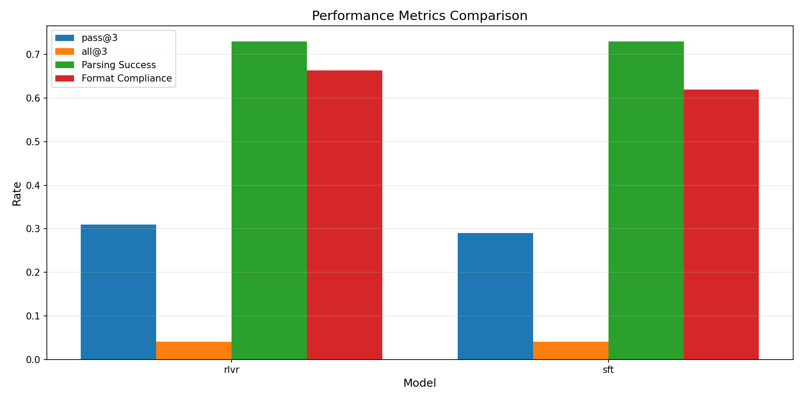

 **Learning to solve integrals from how people actually explain them**

Training Qwen3-4B to solve definite integrals with reasoning. First fine-tune on high-quality Math StackExchange answers, then apply reinforcement learning with verifiable rewards.


## Key Idea

High-quality Math StackExchange answers contain implicit chain-of-thought reasoning. By training on these solutions wrapped in `<think>` tags, the model learns mathematical problem-solving patterns without needing explicit "Step 1, Step 2" annotations.

## Pipeline

1. Extract 444 integral problems and solutions from Math StackExchange
   - Filtered by quality: score higher than 4, at least 2 reasoning keywords ("therefore", "substitute", "consider", "step 1", "next", etc.)
2. Use Claude Sonnet 4 to extract final answers in both LaTeX and SymPy formats
3. Fine-tune Qwen3-4B with LoRA on the solution dataset, outputting answers in \boxed{} format
4. Train with GRPO reinforcement learning using format + verification rewards (78 verified prompts)
5. Evaluate on IntegralBench (100 problems, sorted by difficulty)


---
## Table of Contents

- [1. Data Format](#1-data-format)
- [2. Supervised Fine-Tuning](#2-supervised-fine-tuning)
- [3. Reinforcement Learning with Verifiable Rewards](#3-reinforcement-learning-with-verifiable-rewards)
  - [RLVR Challenges](#4-rlvr-challenges)
- [4. Evaluation](#5-evaluation)
  - [4.1 IntegralBench Dataset](#51-integralbench-dataset)
  - [4.2 Performance Comparison](#52-performance-comparison)
  - [4.3 Example Predictions](#53-example-predictions)
  - [4.4 Future Work: Symbolic Similarity Metrics](#54-future-work-symbolic-similarity-metrics)

---
## 1. Data Format

Training examples use Qwen3's chat template with `enable_thinking=True`:

```json
{
  "messages": [
    {"role": "system", "content": "You are Qwen, created by Alibaba Cloud. You are a helpful assistant."},
    {"role": "user", "content": "Evaluate the integral: $\\int_{0}^{1} x^2 dx$"},
    {"role": "assistant", "content": "<think>\n[MSE solution with reasoning]\n</think>\n\n## The final answer is: $\\boxed{\\frac{1}{3}}$\n## SymPy format: \\boxed{1/3}"}
  ],
  "metadata": {
    "mse_answer_id": 123456,
    "extracted_answer_latex": "\\frac{1}{3}",
    "extracted_answer_sympy": "1/3",
    "numerical_answer": 0.333333
  }
}
```
The SymPy format is key for fast verification (for RLVR). The model's answer can be parsed, evaluated numerically, and compared against ground truth (tolerance 1e-6) to provide a correctness reward signal.


---

## 2. Supervised Fine-Tuning

### SFT Configuration


```yaml
model:
   base: "Qwen/Qwen3-4B"
   
lora:
   r: 64                  
   alpha: 16               
   dropout: 0.05
   target_modules:
     - q_proj
     - k_proj
     - v_proj
     - o_proj
     - gate_proj
     - up_proj
     - down_proj
     
training:
   batch_size: 2
   gradient_accumulation_steps: 8    
   learning_rate: 2.0e-4
   num_epochs: 4
   max_seq_length: 2048
   optimizer: adamw_8bit
   lr_scheduler: cosine
   warmup_steps: 50
```

### Prompt Format

Uses Qwen3 chat template with `enable_thinking=True`:

**Input:**
```
Evaluate the integral: $\int_{0}^{1} x^2 dx$
```

**Expected Output Format:**
```
<think>
We evaluate the integral using the power rule:
$$\int x^2 dx = \frac{x^3}{3} + C$$

Applying the fundamental theorem of calculus:
$$\int_{0}^{1} x^2 dx = \left[\frac{x^3}{3}\right]_0^1 = \frac{1}{3} - 0 = \frac{1}{3}$$
</think>

## The final answer is: $\boxed{\frac{1}{3}}$
## SymPy format: \boxed{1/3}
```

---

## 3. Reinforcement Learning with Verifiable Rewards

### Reward Functions

**1. Format Reward** (0.0 to 1.0, with penalties)
- `<think>` tags with at least 250 chars: +0.25
- "## The final answer is:" header: +0.25
- Exactly 2 `\boxed{}` total: +0.25 (penalty -0.4 if >2)
- "Sympy format" once in last line: +0.25 (penalty -0.4 if >1)

**2. Correctness Reward** (0.0 or 1.0)
- Incorrect or failed verification: 0.0
- Numerically correct (tolerance 1e-4): 1.0

### Adaptive Weight Scheduling

| Epoch | Format | Correctness |
|-------|--------|-------------|
| 0-1 | 0.3 | 0.7 |
| 1-2 | 0.2 | 0.8 |
| 2+ | 0.15 | 0.85 |

Gradually prioritize correctness as format is learned.

### RLVR Configuration

**Starting from the SFT checkpoint**, we apply GRPO reinforcement learning:

```yaml
model:
  base: models/sft/final/qwen3-4b-integral-merged  # SFT checkpoint
  max_seq_length: 2048
  load_in_4bit: true

lora:
  r: 32
  alpha: 32
  dropout: 0.05

training:
  method: GRPO
  batch_size: 1
  gradient_accumulation_steps: 16
  learning_rate: 1.0e-6
  num_epochs: 2
  num_generations: 8
```

### Prompts Dataset

**File:** `data/rlvr/prompts.jsonl` 

Contains integrals from two sources:
- Synthetically created integrals (50)
- Math StackExchange problems (28)

```json
{
  "prompt": [{"role": "user", "content": "Evaluate the integral: $\\int_{0}^{1} x^2 dx$"}],
  "expected_sympy": "1/3",
  "numerical_answer": 0.33333333,
  "has_numerical": true
}
```

---

### RLVR Challenges

RLVR training was challenging. It required extensive experimentation with different hyperparameters (learning rates, batch sizes, reward weights) and prompt datasets (synthetic vs MSE-sourced, verified vs unverified). Even on an A100 GPU, each training run took considerable time, making the iteration cycle slow and resource-intensive.

**Key Takeaways:**
- Verify prompt formatting (GRPO needs message structure)
- Use verified datasets when correctness signal is critical
- Actively penalize violations, don't just withhold rewards
- Monitor KL divergence for policy instability

---

## 4. Evaluation

### 4.1 IntegralBench Dataset

Evaluated on **IntegralBench**, a challenging benchmark for definite integrals ([github](https://github.com/IntegralBench/IntegralBench), [arXiv](https://arxiv.org/abs/2507.21130v1)).

**Dataset:**
- **317 definite integrals**, difficulty 1-5 (mean: 3.52)
- **Evaluation subset:** First 100 problems, sorted from least to most difficult

**Methodology:**
- **3 samples per problem** (temperature=0.6, top_p=0.95)
- **pass@3**: At least 1 out of 3 samples correct 
- **all@3**: All 3 samples correct 
- **Consistency**: Average fraction of correct samples per problem
- **Other metrics**: Parsing success, format compliance, generation time

### 4.2 Performance Comparison

**Overall Results:**

| Model | pass@3 | all@3 | Consistency | Parsing Success | Format Compliance | Mean Gen Time (s) |
|-------|--------|-------|-------------|-----------------|-------------------|-------------------|
| SFT Baseline | 0.290 | 0.040 | 0.143 | 0.730 | 0.620 | 21.16 |
| RLVR Final | 0.310 | 0.040 | 0.163 | 0.730 | 0.663 | 27.05 |

**Performance by Difficulty:**

| Difficulty | RLVR pass@3 | RLVR all@3 | SFT pass@3 | SFT all@3 |
|-----------|-------------|-----------|-----------|-----------|
| 1.0 | 0.375 | 0.062 | 0.406 | 0.062 |
| 2.0 | 0.433 | 0.033 | 0.400 | 0.067 |
| 3.0 | 0.158 | 0.026 | 0.105 | 0.000 |



RLVR training improved format compliance (62% to 66%) with parsing success remaining steady at 73%. Pass@3 accuracy improved from 29% to 31%. The model shows stronger performance on difficulty 2.0 problems (43.3% pass@3).

### 4.3 Example Predictions

#### Correct Solution

**Problem:** $\int_0^1\sin^2(\log x)dx$ 
**Expected Answer:** $\frac{2}{5} = 0.4$

**Model Output:**
```
<think>
The integral can be solved by expanding the square and then integrating term by term.
$$ \int_0^1\sin^2(\log x)dx = \int_0^1\frac{1-\cos(2\log x)}2dx = \frac12\int_0^1dx-\frac12\int_0^1\cos(2\log x)dx $$
The first integral is trivial. The second one can be solved by using substitution $x=e^t$.
$$ \int_0^1\cos(2\log x)dx = \int_{-\infty}^0\cos(2t)e^tdt = \int_{0}^{\infty}\cos(2t)e^{-t}dt $$
This is a well-known Laplace transform, which is given by
$$ \int_0^{\infty}e^{-st}\cos(at)dt = \frac{s}{s^2+a^2} $$
In this case, $s=1$ and $a=2$, so the integral becomes
$$ \int_0^{\infty}e^{-t}\cos(2t)dt = \frac1{1+4} = \frac15 $$
Putting it all together,
$$ \int_0^1\sin^2(\log x)dx = \frac12\cdot1-\frac12\cdot\frac15 = \frac25 $$
</think>

## The final answer is: $\boxed{\frac{2}{5}}$
## Sympy format: \boxed{2/5}
```


#### Error Case 1: Partial Fractions Algebraic Error

**Problem:** $\int_1^2\frac{9x+4}{x^5+3x^2+x}\text{ dx}$ 

**Expected Answer:** $1.25$

**Model Prediction:** $(1+\frac{5}{2}\sqrt{3})\ln 2 \approx 3.69$ 

The model correctly identified the partial fractions approach and attempted to decompose $\frac{9x+4}{x(x^4+3x+1)}$. However, it made errors in solving the system of equations for coefficients, arriving at incorrect values for $B, C, D, E$. 

#### Error Case 2: Correct Symbols, Wrong Coefficients

**Problem:** $\int_0^{2\pi}\left|1+2\sin x\right|dx$ 

**Expected Answer:** $\frac{2\pi}{3} + 4\sqrt{3} \approx 9.02$

**Model Prediction:** $-\frac{5\pi}{6} + \sqrt{3} \approx -0.89$

The model correctly identified the sign changes at $x = \frac{7\pi}{6}$ and $\frac{11\pi}{6}$, split the integral into three piecewise regions, and performed the integration. However, algebraic errors in handling the piecewise antiderivatives led to wrong coefficients.

**Insight:** Both answers are rational linear combinations of the same basis $\{\pi, \sqrt{3}\}$. This partial correctness is invisible to numerical verification. A symbolic similarity metric could detect this shared structure and assign partial credit.

### 4.4 Future Work: Symbolic Similarity Metrics

Current evaluation uses only numerical correctness (tolerance $10^{-4}$), treating all errors as equally wrong. However, Error Case 2 reveals that some incorrect answers are "closer" to correct than others in symbolic structure.

**Proposed approaches:**
- **Bag-of-words on symbolic tokens**: Count occurrences of constants ($\pi$, $e$, $\sqrt{2}$, etc.) and measure cosine similarity
- **Dense vector embeddings**: Use mathematical expression encoders (like IntegralIndx's E-Gen embeddings) to embed answers in a semantic space

These metrics could provide partial credit for answers that demonstrate conceptual understanding but suffer from algebraic execution errors, leading to more nuanced training signals in future RLVR iterations.

---
**Project by Noam Shalev**